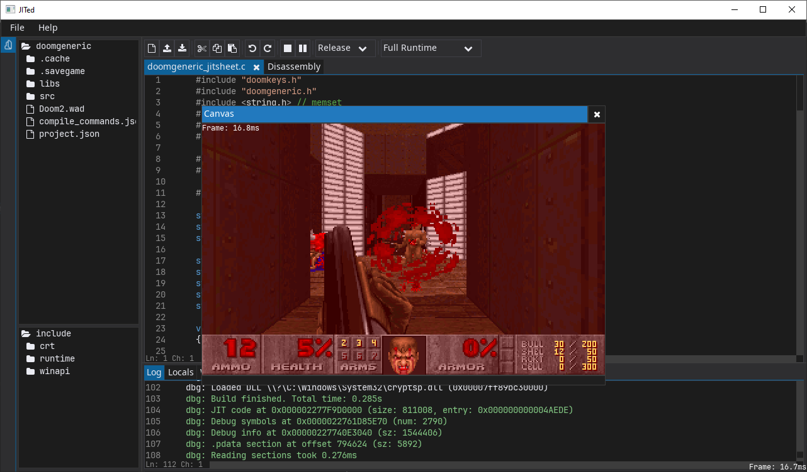
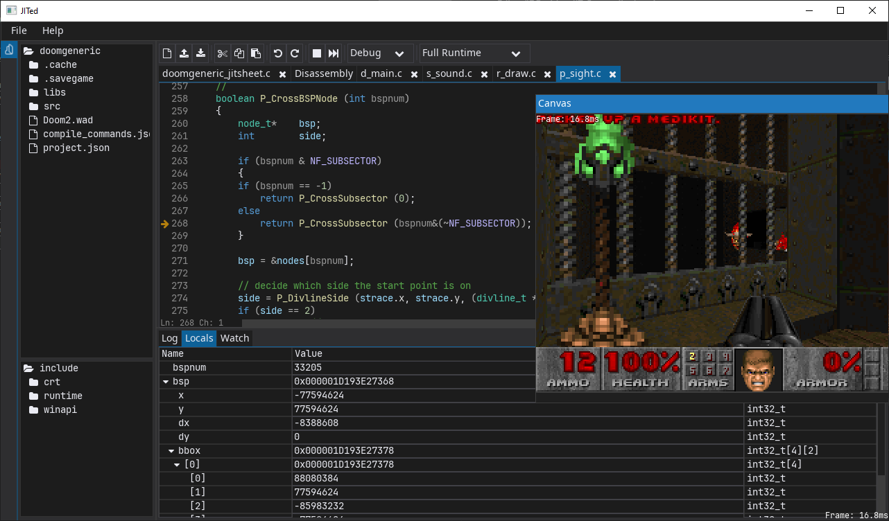
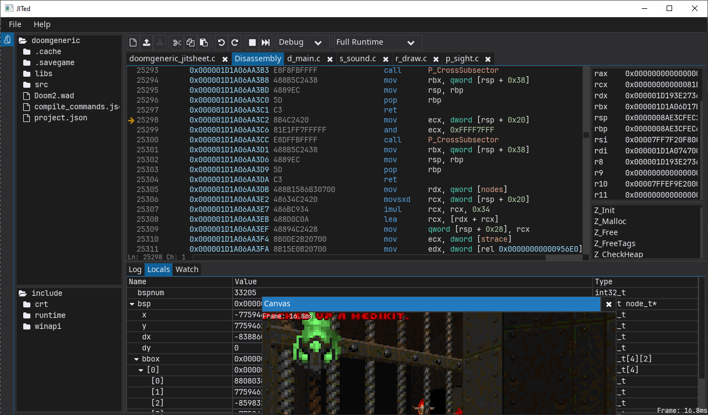
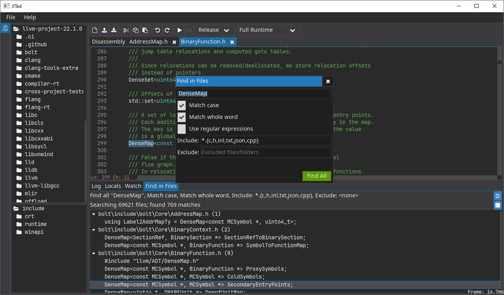
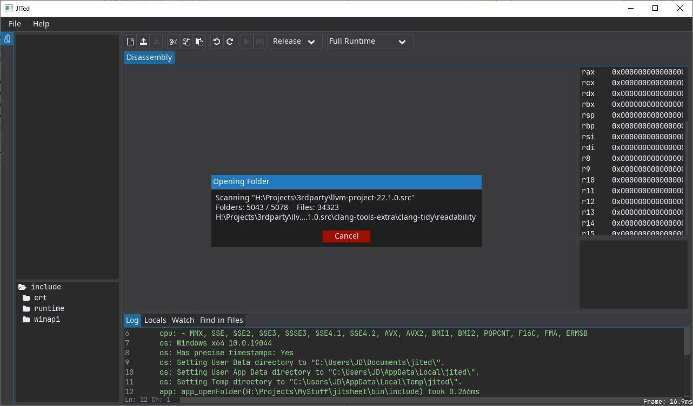

# JITed

Editor/IDE with a JIT C compiler/runtime

**WARNING**: This is a WIP experiment.

Currently works only on Windows and supports only Win64 ABI. Last time I checked it worked correctly under Wine on Debian.

## project.json

If the opened folder contains a `project.json` file it will be used by the runtime. Otherwise, the currently opened script is compiled and executed.

`project.json` allows including multiple source files, include paths, libraries (as `.def` files) and preprocessor macros to be defined for every source file. The available fields are shown below. Not all fields are required.

```json
{
	"sources": [
		"<relative>\\<path>\\<to>\\<source1.c>",
		"<relative>\\<path>\\<to>\\<source2.c>"
	],
	"include_dirs": [
		"<relative>\\<path>\\<to>\\<include dir>"
	],
	"libs": [
		"<relative>\\<path>\\<to>\\<lib.def>"
	],
	"preprocessor": [
        { "name": "MY_MACRO", "value": "1" }
	],
	"runtime": {
		"memory": 0,
		"console_mode": "none"
	},
	"entry_point": "main",
	"working_dir": "<relative path to working directory>"
}
```

**NOTES**: 
- Preprocessor macros should always have a value.
- Include folder and library files can include environment variables. E.g. `"$(VULKAN_SDK)\\Include"`. Both `$()` and `${}` are supported.
- The entry point should be `int entryPoint(void)`. No `argc`, `argv` are passed.
- Paths can also be absolute.
- `runtime.memory` is the total amount of shared memory to allocate for the communication with the editor. The default value (if the field is omitted) is 256Mb.
- `runtime.console_mode` accepts `none` (no console), `open` (opens and closes the console automatically) and `open_wait` (opens the console and waits for user input to close it)

You can find some example `project.json` files in the `examples` folder.

## Screenshots

[](https://raw.githubusercontent.com/jdryg/jited/main/images/jited.png)

[](https://raw.githubusercontent.com/jdryg/jited/main/images/debugger.png)

[](https://raw.githubusercontent.com/jdryg/jited/main/images/disassembly.png)

[](https://raw.githubusercontent.com/jdryg/jited/main/images/find_in_files.png)

[](https://raw.githubusercontent.com/jdryg/jited/main/images/async_folder_opening.png)

## 3rd party libraries used

- [sokol gfx + app + glue](https://github.com/floooh/sokol)
- [stb_sprintf.h](https://github.com/nothings/stb_sprintf/blob/main/stb_sprintf.h)
- [json.h](https://github.com/vurtun/lib/blob/master/json.h) 
- [sched.h](https://github.com/vurtun/lib/blob/master/sched.h)
- [xxhash](https://github.com/Cyan4973/xxHash)
- [tlsf](https://github.com/mattconte/tlsf)
- [yyjson](https://github.com/ibireme/yyjson)
