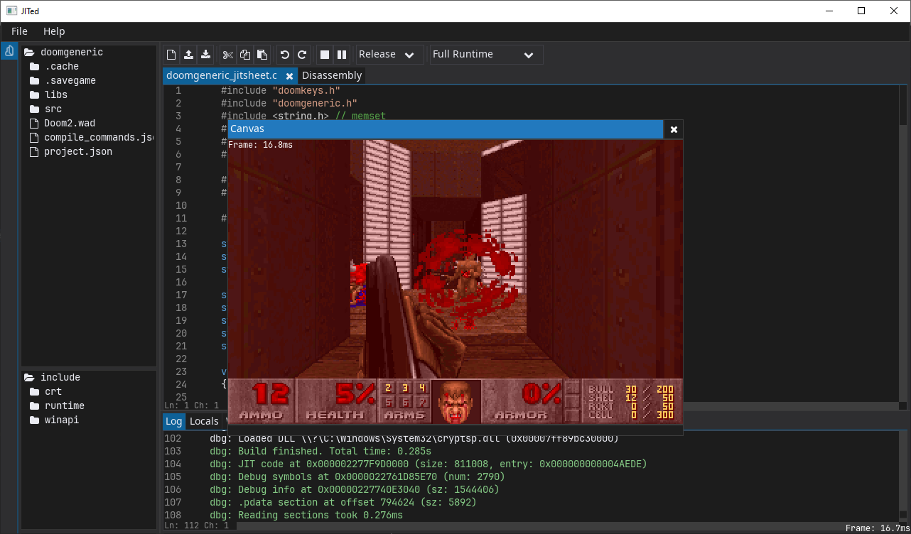
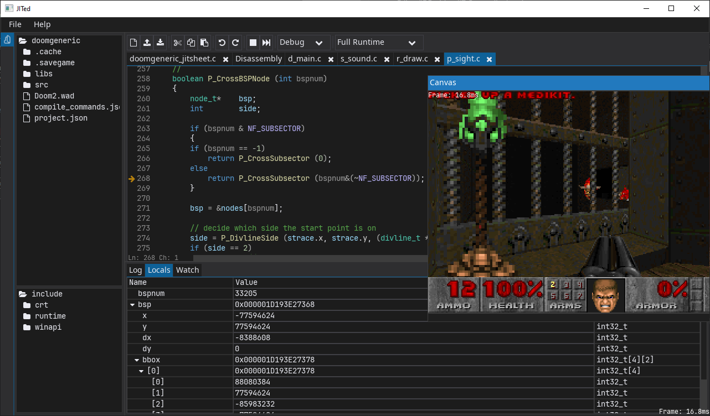
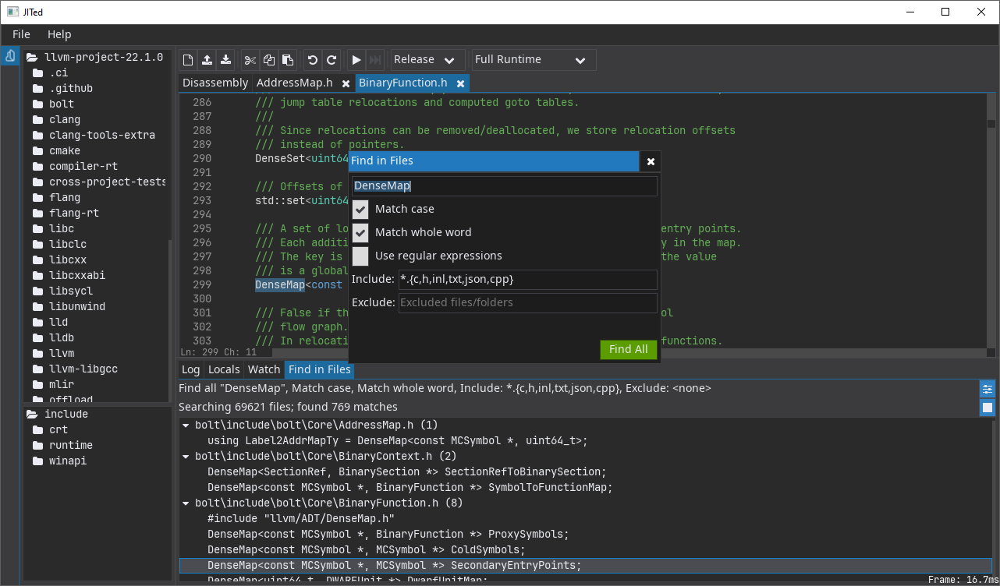
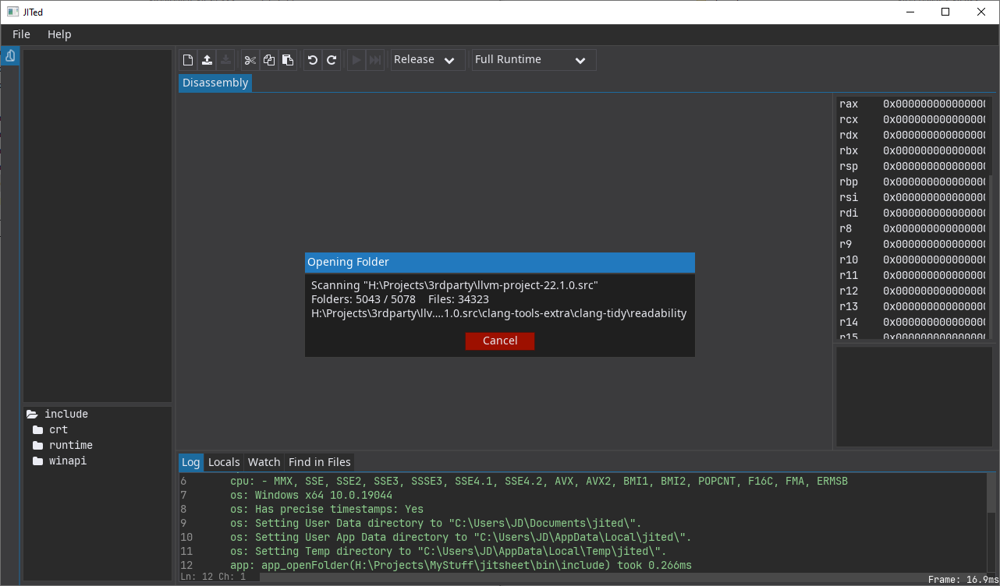

# JITed

Editor/IDE with a JIT C compiler/runtime

**WARNING**: This is a WIP experiment.

Currently works only on Windows and supports only Win64 ABI. Last time I checked it worked correctly under Wine on Debian.

## Screenshots

## 3rd party libraries used

- [sokol gfx + app + glue](https://github.com/floooh/sokol)
- [stb_sprintf.h](https://github.com/nothings/stb_sprintf/blob/main/stb_sprintf.h)
- [json.h](https://github.com/vurtun/lib/blob/master/json.h) 
- [sched.h](https://github.com/vurtun/lib/blob/master/sched.h)
- [xxhash](https://github.com/Cyan4973/xxHash)
- [tlsf](https://github.com/mattconte/tlsf)
- [yyjson](https://github.com/ibireme/yyjson)
